<div align="center">


# Not So Smart OCR

**Document extraction you can inspect.**

Text · Tables · Handwriting · Formulas · Checkboxes · Source-linked review

[How it works](#how-it-works) · [Results](#results) · [Examples](#examples) · [Serving](#serving-and-dashboard) · [Walkthroughs](#walkthroughs)

</div>

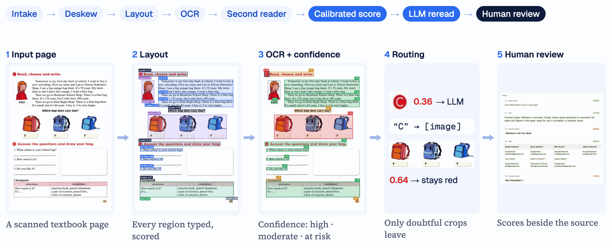

Not So Smart OCR turns PDFs, scans, faxes and phone photos into text, tables, handwriting, formulas and checkbox states.
Every word links back to the region it came from, with a calibrated confidence.
Only the regions it doubts go to an LLM, and whatever is still uncertain waits for a person in the review workbench.

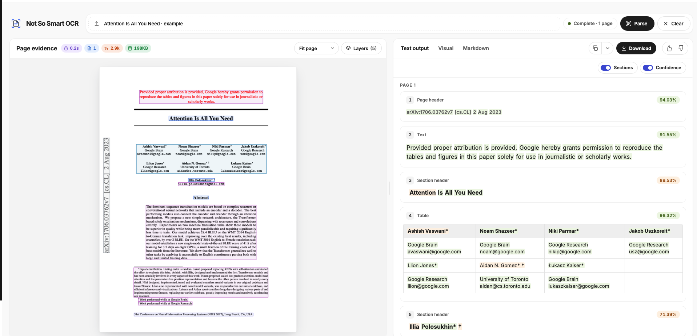

## Features

- Extract text and structure from PDFs and images.
- Inspect colored layout boxes and download full-resolution source crops.
- Review formulas, tables, images, and detected checkbox states.
- Explore text, visual, Markdown, and JSON views of the same evidence.
- See a calibrated confidence for every region: high, medium, or low.
- Select output to locate its source, inspect regional scores, and edit a transcription in a multiline editor with its crop alongside it.
- Saved edits update Text output, Markdown, and JSON together while retaining the original reading in the evidence history.
- Fit the full page, navigate multi-page documents, and use the responsive light or dark interface.
- Save feedback with its image and result, retaining 1,000 records locally.
- Watch long PDFs fill in page by page, and see your place in line while other documents are read.
- Follow usage, routing, latency, spend, and the live queue in a separate, token-protected admin dashboard.

## How it works

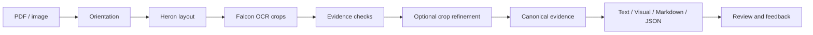

The demo verified on 29 September 2026 uses docTR orientation and skew estimation, Heron layout inside the native Falcon server, complete-region Falcon OCR, and evidence checks.
Optional Qwen3.7 Flash crop refinement is enabled in the updated demo screenshots; it requires a separately configured hosted API and spending limit.
Source pixels and canonical evidence are retained, with local KaTeX for math.
The demo composition endpoint reports the configuration of each running service.

### 1. Intake: two paths

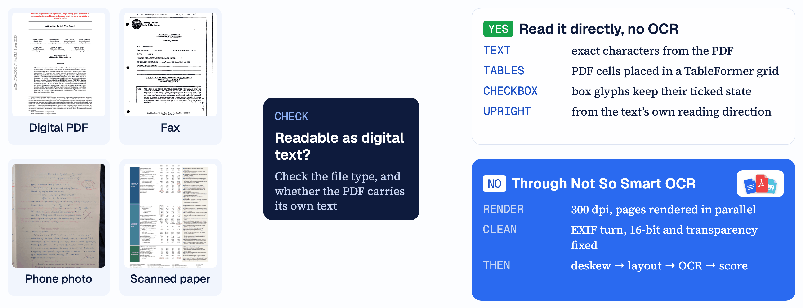

A born-digital PDF keeps its own text: characters come from the PDF text layer, and tables are rebuilt with Docling's TableFormer over the page's own text cells.
Scanned PDF pages are rendered at 300 dpi; faxes, photos and other images go to the pipeline as they are.
Uploads can be PDF, PNG, JPG, TIFF, WEBP or BMP.

### 2. Orientation and skew

The served pipeline turns pages upright with docTR's orientation classifier and levels them with jdeskew before layout.
[LevelHead](https://github.com/beingamanforever/LevelHead) is our training-free method for pages at any angle, developed in its own repository: level the page first, then let any orientation model vote over the four quarter turns and combine the votes with a geometric mean.

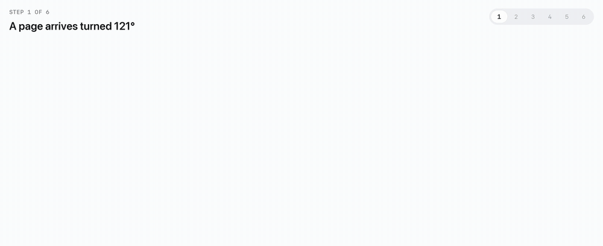

jdeskew reads the tilt from the angle of the text streak in the page's spectrum.
On phone photos it drew a false ink edge where it padded the image, and that edge pulled every estimate to 0°.
Thresholding before padding removes that edge, a fix [merged upstream](https://github.com/phamquiluan/jdeskew/pull/30).
LevelHead also tapers the page edges before the FFT, so the text streak wins.

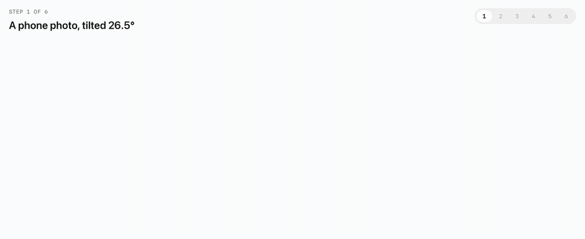

### 3. Layout, checkboxes and reading order

IBM's Heron layout model finds every region and names it with one of 17 classes.
The class decides how a region is read: as text, as a table grid, or as an image.

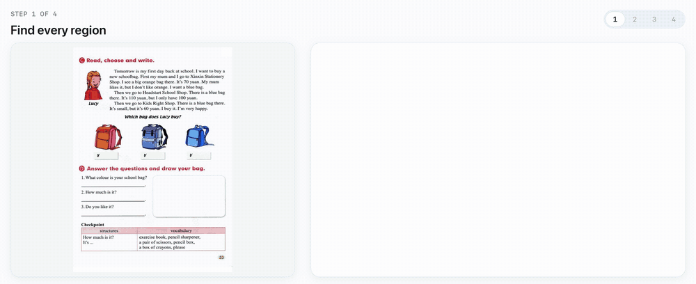

Small checkboxes vanish at the detector's input size, so form, key-value and table regions are also read as overlapping tiles.
Tile detections map back to page coordinates and merge with the page pass.

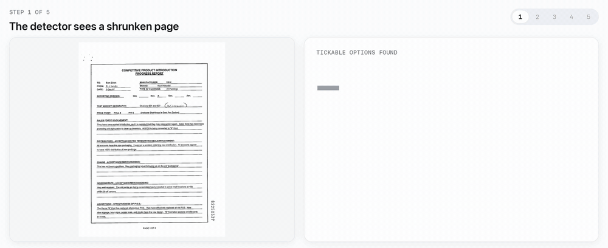

Reading order is a recursive XY-cut over the detected regions that keeps form fields and records together.
With OmniDocBench English ground-truth boxes, its order edit distance is 0.043 against 0.064 for Docling's rule-based order on text pages, and 0.046 against 0.110 on table pages.

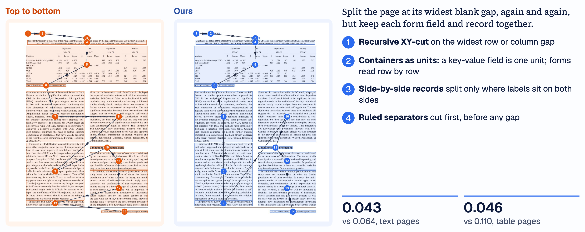

### 4. OCR: one crop per region

Every region becomes its own crop, read whole by Falcon-OCR (about 300M parameters) with the prompt for its category.
docTR reads the same words again as a second reader, and disagreements become evidence for routing.

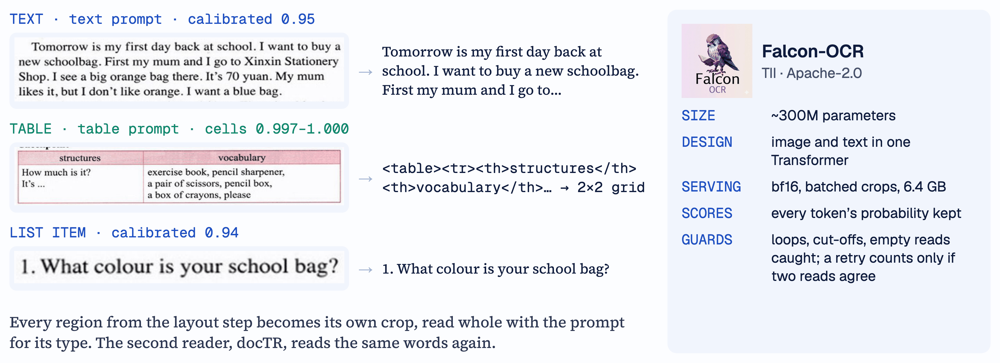

### 5. Calibrated confidence

Falcon's mean token log-probability and Heron's detection score are combined by Platt scaling into one number: the probability that the region's text is within 10% normalized edit distance of the truth.
Fitted on 1,331 OmniDocBench text regions with document-grouped 5-fold cross-validation, calibration error falls from 0.121 for the raw token score to 0.044, with AUROC 0.93.

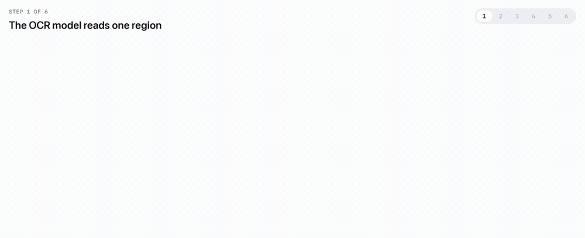

Regions at 0.90 and above are high, 0.70 and above medium, and the rest low.

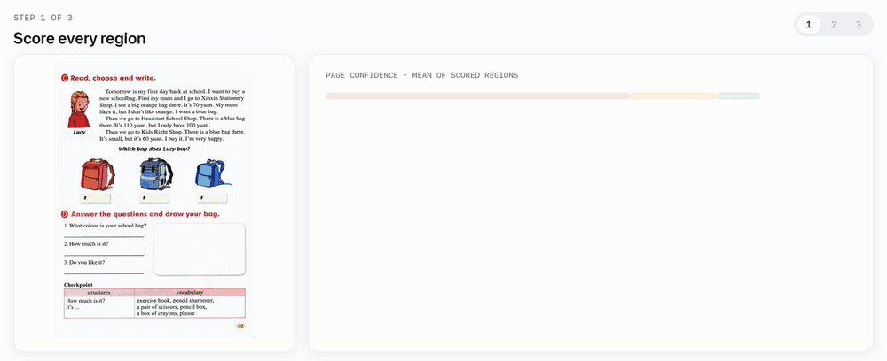

### 6. Routing: one LLM pass, merged back by crop ID

Only regions with a specific doubt signal leave, such as likely misread text, an unresolved read, a letter among digits, a visual region, or a broken table.
Their crops are stitched into labelled sheets of up to 12 per request, each crop is read once, and each answer returns to its region by crop ID.

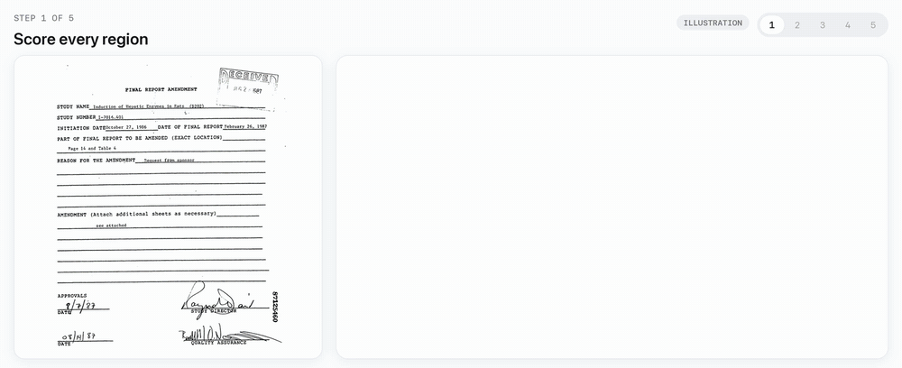

On OmniDocBench English the LLM roughly halves character error where Falcon's own signals flag a region: 0.311 to 0.162 on likely misread table text, and 0.093 to 0.043 on unresolved text.
On the same pages, deployed routing sends 24 to 38% of regions, for $0.12 to $0.18 of LLM spend per 1,000 pages; see [Routing between Falcon and Qwen](docs/walkthroughs/10-routing-evaluation.md).

### 7. Human review

Every line sits beside its source box with its confidence.
A reviewer can edit a transcription with its crop alongside, or keep it unresolved; edits update Text, Markdown and JSON together and keep the original reading in the evidence history.

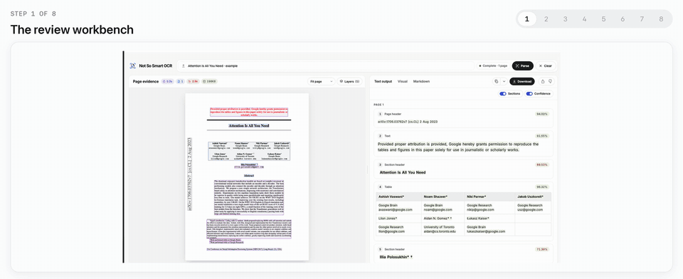

| Inspect a source region | Edit a transcription |
| --- | --- |
| 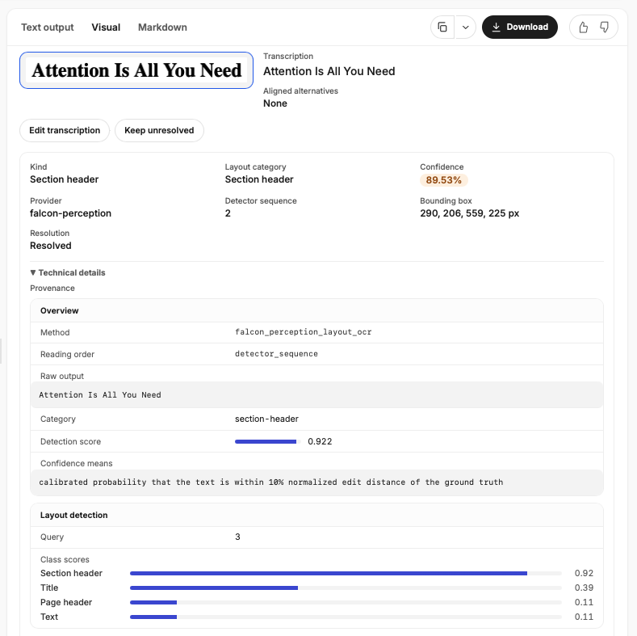 | 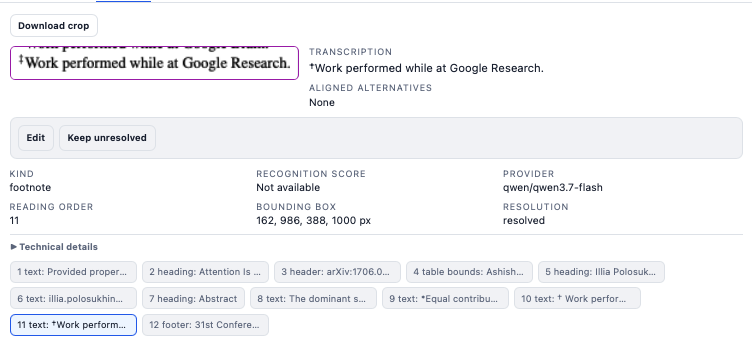 |

Image-decode reuse, lighter response transfer, and overlapping local OCR with hosted refinement reduce overhead while preserving original OCR inputs and canonical exports.
Parallel page rereads and CPU layout tiles reduced one warm three-page run from 84.6 to 52.5 seconds on an A10G, with partial results retained.
Four paired native OCR comparisons preserved the complete response except timing metadata.
Single-page hosted latency remains a bottleneck; see the [measurements and preservation limits](docs/walkthroughs/latency-preservation.md).
The UI loads source crops on demand; downloaded JSON retains their original PNG data.

## Results

Scored with the official tools on 1 October 2026, against the deployed build on one NVIDIA A10G.

**OmniDocBench v1.6, all 755 English pages**

| Text edit ↓ | Formula CDM ↑ | Table TEDS ↑ | Reading-order edit ↓ | Overall ↑ |
| ---: | ---: | ---: | ---: | ---: |
| 0.0545 | 91.59 | 78.50 | 0.128 | **88.21** |

**ParseBench, all 2,079 documents**

| | Overall | Tables | Charts | Content faithfulness | Semantic formatting | Visual grounding |
| --- | ---: | ---: | ---: | ---: | ---: | ---: |
| This pipeline | 50.99 | 53.84 | 1.26 | 86.62 | 48.36 | 64.88 |
| Falcon-OCR alone (leaderboard) | 53.08 | 74.70 | 0.82 | 78.59 | 47.91 | 63.37 |

The public OmniDocBench leaderboard averages all 1,651 pages, Chinese included, so the English-only score places the pipeline only approximately.
See [Public benchmarks](docs/walkthroughs/11-public-benchmarks.md) for the setup, the comparison, and where the pipeline loses points.

## Examples

| Type | Example | View |
| --- | --- | --- |
| Paper | Attention Is All You Need | [Output](artifacts/demo/paper-ui.png) |
| Handwriting and math | Physics notes | [Output](artifacts/demo/notes-ui.png) |
| Printed math | Scanned calculus formulas | [Output](artifacts/demo/printed-math-ui.png) |
| Tables | Public financial report | [Output](artifacts/demo/table-ui.png) |
| Screenshot | GSoC Final Evaluation | [Output](artifacts/demo/gsoc-ui.png) |

| Academic layout | Handwritten formulas |
| --- | --- |
| 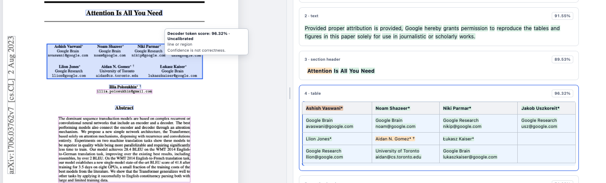 | 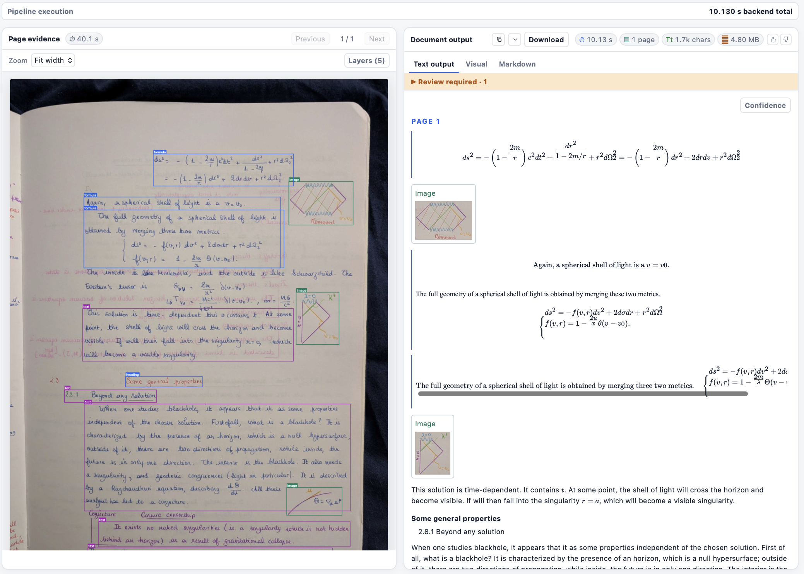 |
| **Text and images** | **Printed mathematics** |
| 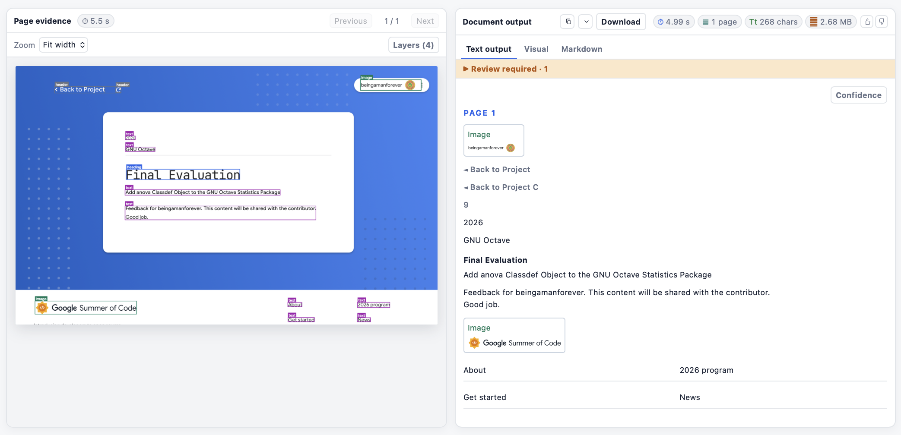 | 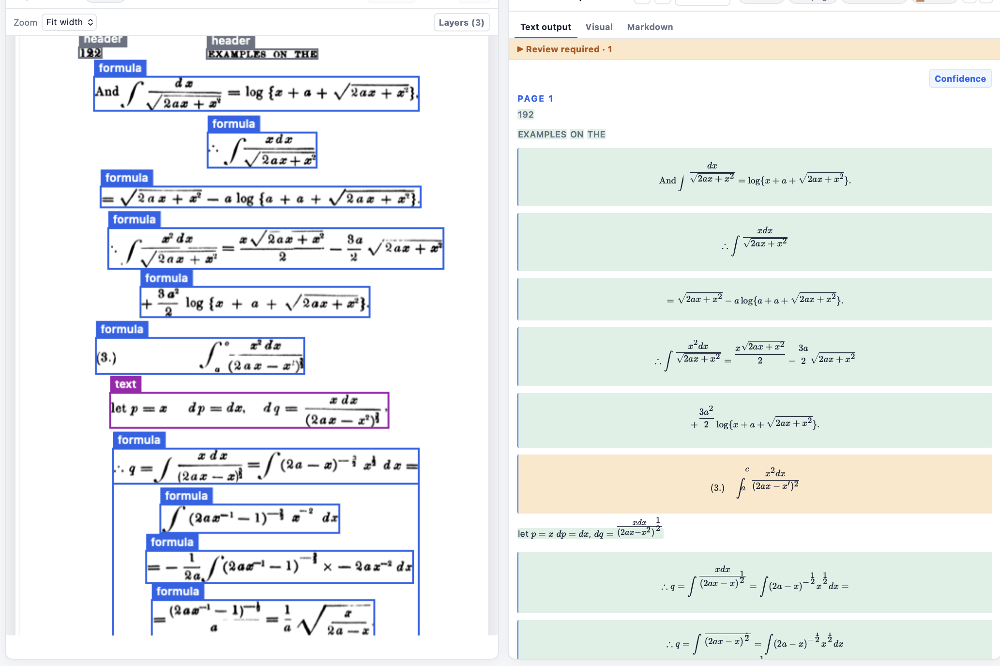 |

The workbench and inspector screenshots were updated on 30 September 2026; the academic paper and source-selection screenshots on 29 September 2026.
Screenshots show actual output, including errors.
Overlapping regions can still produce duplicates; handwriting, numeric fields, and reading order remain imperfect.
Confidence is calibrated on printed OmniDocBench text, and a hosted reread may not provide a recognition score.
The figures and animations above use public pages only; private documents and datasets are excluded.

## Serving and dashboard

Parses reach the GPU one at a time, in arrival order.
Waiting uploads see how many documents are ahead of them; past 32 running or waiting parses, new uploads get a `503` with `Retry-After`.
Long PDFs show each page as soon as it is read.
In a burst of ten concurrent uploads on the A10G host, all ten were served in order, and the page still loaded in under 0.09 s.

Two in-memory, byte-bounded caches with a time limit reuse page readings and complete LLM replies for byte-identical input; repeated parses took 0.1 to 0.8 s instead of 9 to 16 s, with identical results.
An LLM reply that is cut off or has one malformed record keeps every crop it answered correctly; a provider failure in the middle of a streamed reply is retried.

`/admin` is off unless an admin token is configured.
It shows requests, pages, users, latency split into OCR, LLM, and waiting time, LLM spend, cache use, routing reasons, and the live queue, with each request's page, routed regions, and confidence scores.

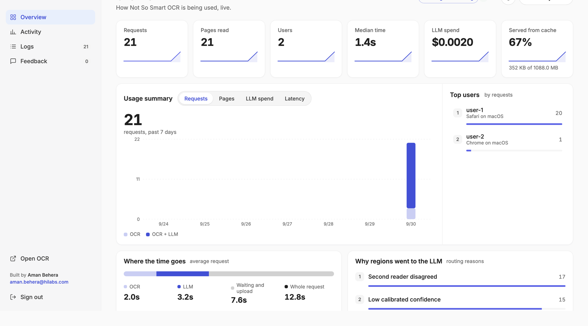

```bash
OPENROUTER_API_KEY=... OCR_ADMIN_TOKEN=... python experiments/serve_gpu_demo.py --falcon-layout-url http://127.0.0.1:8196 \
  --qwen-crops --qwen-budget-usd 5 --usage-root ~/ocr-state/usage --feedback-root ~/ocr-state/feedback \
  --page-cache-mb 1024 --qwen-reply-cache-mb 64 --max-active-parses 32
```

Keep usage records, feedback, and the spending ledger on persistent storage; instance storage is erased when a cloud instance stops.
See [Serving under load](docs/walkthroughs/09-serving-queue-cache-dashboard.md) for measurements, the failure that motivated these changes, and operating advice.

## Walkthroughs

Walkthroughs grounded in the code, technical reports, and measured runs:

| Read | Covers |
| --- | --- |
| [From pixels to text](docs/walkthroughs/01-from-image-to-text.md) | The running pipeline and model choices |
| [Layout, tables, and Falcon contributions](docs/walkthroughs/02-layout-tables-and-crops.md) | Geometry, crops, duplicates, and upstream fixes |
| [Confidence, Markdown, and review](docs/walkthroughs/03-confidence-exports-and-review.md) | Token scores, rendering, exports, and feedback |
| [Model internals and hardware](docs/walkthroughs/04-model-internals-and-hardware.md) | DETR, orientation, table recognition, and VRAM |
| [Inside Falcon-OCR](docs/walkthroughs/05-falcon-technical-report.md) | Early fusion, attention, training, and native serving |
| [Document-parsing strategies](docs/walkthroughs/06-document-parsing-strategies.md) | Seven OCR systems and their architectural trade-offs |
| [From research to implementation](docs/walkthroughs/07-research-to-implementation.md) | What we reused, what each paper taught us, and observed improvements |
| [Fidelity repairs and routing results](docs/walkthroughs/08-fidelity-and-routing.md) | Current runtime, preserved table content, paired Qwen comparison, and remaining failures |
| [Serving under load](docs/walkthroughs/09-serving-queue-cache-dashboard.md) | Fair queue, page streaming, caching, robust LLM replies, the admin dashboard, and operations |
| [Routing between Falcon and Qwen](docs/walkthroughs/10-routing-evaluation.md) | What each routing signal is worth, controlled A/B arms, cost per 1,000 pages, and what was rejected |
| [Public benchmarks](docs/walkthroughs/11-public-benchmarks.md) | OmniDocBench v1.6 English (overall 88.2) and ParseBench (51.0), scored with the official tools |

**Hardware:** exercised on a 24 GB-class NVIDIA A10G. Minimum VRAM is not established; see the [memory breakdown](docs/walkthroughs/04-model-internals-and-hardware.md#vram-and-performance).

## Related

- [LevelHead](https://github.com/beingamanforever/LevelHead) ([project page](https://beingamanforever.github.io/LevelHead/)): document orientation at any angle, by levelling first and then voting.
- [jdeskew pull request #30](https://github.com/phamquiluan/jdeskew/pull/30): the deskewer fix for phone photos, merged upstream.

## Acknowledgements

Thank you to the teams behind [Falcon-Perception](https://github.com/tiiuae/Falcon-Perception), [IBM's Heron layout model](https://huggingface.co/docling-project/docling-layout-heron-101), [DocTR](https://github.com/mindee/doctr), [jdeskew](https://github.com/phamquiluan/jdeskew), [Tesseract](https://github.com/tesseract-ocr/tesseract), [Poppler](https://gitlab.freedesktop.org/poppler/poppler), and [KaTeX](https://github.com/KaTeX/KaTeX). Heron comes from the Docling project. Their respective licenses apply.
