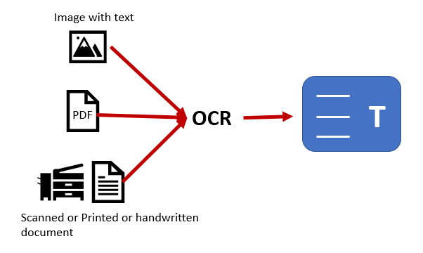
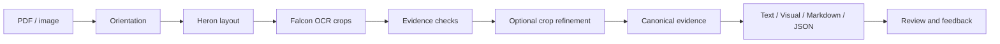

# Not So Smart OCR

**Document extraction you can inspect.**

Text · Tables · Handwriting · Formulas · Source-linked review

[Examples](#examples) · [Pipeline](#pipeline) · [Walkthroughs](#walkthroughs)

OCR turns text in images, PDFs, and scanned or handwritten documents into editable text.

## Features

- Extract text and structure from PDFs and images.
- Inspect colored layout boxes and download full-resolution source crops.
- Review formulas, tables, images, and detected checkbox states.
- Explore text, visual, Markdown, and JSON views of the same evidence.
- Select output to locate its source, inspect regional scores, and edit a transcription in a multiline editor with its crop alongside it.
- Saved edits update Text output, Markdown, and JSON together while retaining the original reading in the evidence history.
- Fit the full page, navigate multi-page documents, and use the responsive light or dark interface.
- Save feedback with its image and result, retaining 1,000 records locally.

## Examples

| Type | Example | View |
| --- | --- | --- |
| Paper | Attention Is All You Need | [Output](artifacts/demo/paper-ui.png) |
| Handwriting and math | Physics notes | [Output](artifacts/demo/notes-ui.png) |
| Printed math | Scanned calculus formulas | [Output](artifacts/demo/printed-math-ui.png) |
| Tables | Public financial report | [Output](artifacts/demo/table-ui.png) |
| Screenshot | GSoC Final Evaluation | [Output](artifacts/demo/gsoc-ui.png) |

| Academic layout | Handwritten formulas |
| --- | --- |
|  |  |
| **Text and images** | **Printed mathematics** |
|  |  |

| Inspect a source region | Edit a transcription |
| --- | --- |
|  |  |

The workbench, academic paper, source-selection, and inspector screenshots were updated on 29 September 2026.
Screenshots show actual output, including errors.
Overlapping regions can still produce duplicates; handwriting, numeric fields, and reading order remain imperfect.
Model scores are uncalibrated, and a hosted reread may not provide a recognition score.
Private documents and datasets are excluded.

## Pipeline

The demo verified on 29 September 2026 uses docTR orientation and skew estimation, Heron layout inside the native Falcon server, complete-region Falcon OCR, and evidence checks.
Optional Qwen3.7 Flash crop refinement is enabled in the updated demo screenshots; it requires a separately configured hosted API and spending limit.
Source pixels and canonical evidence are retained, with local KaTeX for math.
The demo composition endpoint reports the configuration of each running service.

Image-decode reuse, lighter response transfer, and overlapping local OCR with hosted refinement reduce overhead while preserving original OCR inputs and canonical exports.
Parallel page rereads and CPU layout tiles reduced one warm three-page run from 84.6 to 52.5 seconds on an A10G, with partial results retained.
Four paired native OCR comparisons preserved the complete response except timing metadata.
Single-page hosted latency remains a bottleneck; see the [measurements and preservation limits](docs/walkthroughs/latency-preservation.md).
The UI loads source crops on demand; downloaded JSON retains their original PNG data.

## Walkthroughs

Walkthroughs grounded in the code, technical reports, and measured runs:

| Read | Covers |
| --- | --- |
| [From pixels to text](docs/walkthroughs/01-from-image-to-text.md) | The running pipeline and model choices |
| [Layout, tables, and Falcon contributions](docs/walkthroughs/02-layout-tables-and-crops.md) | Geometry, crops, duplicates, and upstream fixes |
| [Confidence, Markdown, and review](docs/walkthroughs/03-confidence-exports-and-review.md) | Token scores, rendering, exports, and feedback |
| [Model internals and hardware](docs/walkthroughs/04-model-internals-and-hardware.md) | DETR, orientation, table recognition, and VRAM |
| [Inside Falcon-OCR](docs/walkthroughs/05-falcon-technical-report.md) | Early fusion, attention, training, and native serving |
| [Document-parsing strategies](docs/walkthroughs/06-document-parsing-strategies.md) | Seven OCR systems and their architectural trade-offs |
| [From research to implementation](docs/walkthroughs/07-research-to-implementation.md) | What we reused, what each paper taught us, and observed improvements |
| [Fidelity repairs and routing results](docs/walkthroughs/08-fidelity-and-routing.md) | Current runtime, preserved table content, paired Qwen comparison, and remaining failures |

**Hardware:** exercised on a 24 GB-class NVIDIA A10G. Minimum VRAM is not established; see the [memory breakdown](docs/walkthroughs/04-model-internals-and-hardware.md#vram-and-performance).

## Acknowledgements

Thank you to the teams behind [Falcon-Perception](https://github.com/tiiuae/Falcon-Perception), [IBM's Heron layout model](https://huggingface.co/docling-project/docling-layout-heron-101), [DocTR](https://github.com/mindee/doctr), [Tesseract](https://github.com/tesseract-ocr/tesseract), [Poppler](https://gitlab.freedesktop.org/poppler/poppler), and [KaTeX](https://github.com/KaTeX/KaTeX). Heron comes from the Docling project. Their respective licenses apply.
